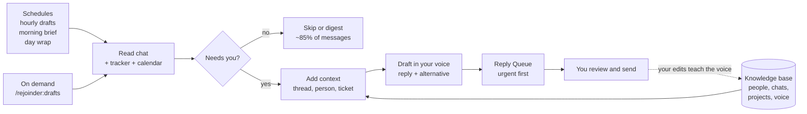
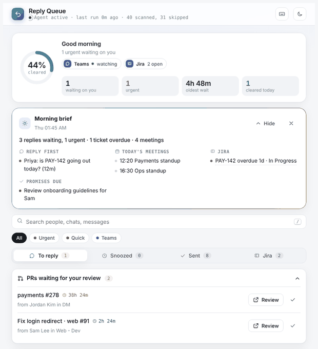

# Rejoinder

[](https://github.com/Zeeshan138063/rejoinder/actions/workflows/validate.yml) 

**Your replies, drafted in your voice. You press send.**

Rejoinder is a plugin for Claude. It watches your work chat during working hours, skips the noise, and drafts replies in your own voice with context from the thread, the person and your tracker. It also gives you a morning brief, an end-of-day wrap, your open Jira tickets and a standup draft. Every draft waits for you; it never sends anything on its own.

> *rejoinder* (noun): a reply, especially a quick and well-judged one.

If you lead a team, you get tagged in a dozen chats all day. Most of it is banter, FYIs and meeting chatter. The few messages that really need you get buried, and some get missed. Rejoinder reads that chat for you, through the day, and writes the replies that are needed.



<p align="center"></p>

<p align="center">
  
  
</p>
<p align="center">
  
  
</p>
<p align="center"><sub>Sample data. Names and messages are made up.</sub></p>

## When it runs

Rejoinder is not one hourly job. It has several schedules plus on-demand commands, and setup creates the schedules for you in your own time zone and working days.

| What | When | What you get |
| --- | --- | --- |
| **Reply drafts** (`/rejoinder:drafts`) | Every hour in your working hours, at a few minutes past the hour. Example: 09:07, 10:07 … 18:07 on weekdays | New drafts in the Reply Queue, urgent first. If anything is urgent, a phone notification that starts with `URGENT:` |
| **Morning brief** (`/rejoinder:brief`) | About 30 minutes after your day starts | Pinned to the top of the queue: what to reply to first, today's meetings, overdue and due tickets, promises due, PRs to review, what you're waiting on |
| **End-of-day wrap** (`/rejoinder:brief`) | About 30 minutes before your day ends | What got done, what's still waiting on you, promises not done, tomorrow's first meetings and due tickets, and a standup draft |
| **On demand** | Any time, e.g. right after a meeting | Run `/rejoinder:drafts` or `/rejoinder:brief` yourself; the result is the same as a scheduled run and urgent drafts are also shown in chat |
| **Instant VIP alerts** (optional) | Within seconds of the message | A phone notification for your manager, CTO, PM or "prod is down" messages, through a small [Power Automate or Slack workflow](docs/instant-alerts.md). The full draft follows on the next run |
| **Jira tab** (optional) | Live while the queue page is open, refreshed every 10 minutes | Your open tickets and Ask Jira answers, straight from Jira |
| **Housekeeping** | During each hourly run | Messages you already answered are marked sent; sent cards older than 30 days and reviewed PRs older than 14 days are removed |

You can change any schedule by telling Claude, e.g. "move my morning brief to 9:45" or "pause Rejoinder on Fridays", or in Claude's scheduled tasks settings.

## What it does

### Replies

| Feature | What you get |
| --- | --- |
| **Mention watcher** | Finds direct messages, @mentions and requests aimed at you since the last run. |
| **Noise filter** | Skips banter, polls, emoji-only messages, system events and muted chats. Status updates go into a one-line digest. |
| **Priority lanes** | **Urgent** (VIPs, "prod", "client", "go live", requests waiting too long), **Quick** (one-tap replies to "quick call?" or "ok to merge?") and **Normal**. |
| **Drafts in your voice** | Learns your style from your own messages: length, languages, greetings, sign-off, how you write to your manager or to a junior dev. Each message gets a main draft and a shorter alternative. |
| **Context** | Each draft rests on the thread before it, a memory of the person and the chat, and the ticket's status if you use a tracker. Anything it doesn't know becomes a `<placeholder>` so you never send a guess. |
| **Send in Teams** | For 1:1 Teams chats, it opens the chat with your reply already typed in. You press Enter. Other chats: copy and open. |
| **Already-answered check** | No drafts for messages you already replied to in the same conversation. |
| **Learns from your edits** | When you change a draft before sending, the difference is saved and used for the next drafts. |
| **Works while your computer sleeps** | A cloud copy of the knowledge base keeps hourly runs fully informed. |

### Your day

| Feature | What you get |
| --- | --- |
| **Morning brief & day wrap** | A short card pinned to the top of the queue, twice a day. |
| **Commitment tracker** | Catches your own "I'll check", "will send by EOD" and adds them to your task list, along with what you are waiting on from others. |
| **PR review queue** | Review requests people send you in chat, with how long each has waited and a "Mark reviewed" button. |
| **Insights** | On the Sent tab: typical reply time, % of drafts sent as written, urgent answered within 2h, busiest people and chats, a 7-day chart. |
| **Security check** | Flags it if you posted a password or token in chat, so you can rotate it. |

### Jira (optional)

| Feature | What you get |
| --- | --- |
| **My Jira tab** | Your open tickets live from Jira: priority, type, status, epic, due date, labels, stale tickets and tickets someone asked about in chat. Filter, sort and group; stats follow the selected project. |
| **Ask Jira** | Ask "how many tickets closed today?" or "bugs assigned to Sam". Claude turns it into JQL and shows the count, To do / In progress / Done cards, filters and a per-assignee chart. |
| **Status chips on replies** | Any ticket a message mentions shows its live status on the reply card. |
| **Quick actions** | Move a ticket's status or add a comment, each behind a confirm click. |
| **Write my standup** | Drafted in your voice from Jira activity and the replies you sent. |
| **No Rovo credits** | Uses only plain Jira lookups, never Atlassian's paid cross-product search. |

## Requirements

- **Claude:** Cowork (desktop app) or Claude Code, with scheduled tasks and Artifacts available.
- **A chat connector:** Microsoft Teams (Microsoft 365 connector) is tested. Slack, Discord and Google Chat should work through their connectors; see [CONNECTORS.md](plugins/rejoinder/CONNECTORS.md).
- **Optional:** a tracker (Jira via the Atlassian connector is tested; Linear, Asana and GitHub Issues should work) and a calendar for the morning brief.
- **Knowledge base on your computer:** keep the Claude desktop app open during working hours for the richest context. When the computer sleeps, runs use the cloud copy.

## Install

**Claude Code**

```
/plugin install rejoinder --marketplace Zeeshan138063/rejoinder
```

On older versions:

```
/plugin marketplace add Zeeshan138063/rejoinder
/plugin install rejoinder@rejoinder
```

**Claude Cowork (desktop app)**

Download `rejoinder.plugin` from the [latest release](https://github.com/Zeeshan138063/rejoinder/releases) and add it in Claude's plugin settings. You can also ask Claude to "install the plugin from github.com/Zeeshan138063/rejoinder".

### Upgrading from Reply Agent

Rejoinder was called Reply Agent before v0.2.0. Your agent folder, config and Reply Queue page keep working; only the plugin and command names changed.

```
/plugin uninstall reply-agent@reply-agent
/plugin marketplace remove reply-agent
/plugin marketplace add Zeeshan138063/rejoinder
/plugin install rejoinder@rejoinder
```

Then ask Claude to "update my Rejoinder scheduled tasks to use `rejoinder:drafts` and `rejoinder:brief`".

## Set up (about 10 minutes)

Run:

```
/rejoinder:setup
```

It will:

1. Ask for your chat tool, tracker (or none), working hours and time zone.
2. Read the last 14 days of your chat to learn who you work with, which chats are noise, and what is still open.
3. Learn your voice from messages **you** wrote, and show you a summary to confirm.
4. Create your agent folder: config, short working memory, people, chats, projects, voice and tasks.
5. Publish your private Reply Queue page.
6. Schedule the hourly drafts, and offer the morning brief and end-of-day wrap.
7. Run once, so you have real drafts straight away.

## Commands

| Command | Use it for |
| --- | --- |
| `/rejoinder:setup` | First-time setup, or changing hours, VIPs and muted chats |
| `/rejoinder:drafts` | Check chat and draft replies now |
| `/rejoinder:brief` | Write the morning brief or day wrap now |

## Configure

All settings live in `config.md` in your agent folder. Edit them by hand, or tell Claude, e.g. "mute the #random channel" or "add my skip-level as a VIP". See the [config template](plugins/rejoinder/skills/setup/references/config-template.md).

## Privacy and safety

- **It only drafts.** It never sends, posts, reacts or edits in chat or email. Jira changes happen only when you click and confirm in the Jira tab.
- **It reads only what you can already read**, through your own connectors and permissions.
- **Your data stays yours.** The knowledge base is plain markdown in a folder you choose. The Reply Queue is a private page that only you, and editors you add, can read.
- **No secrets are stored.** Passwords, tokens, payslips and personal data are left out of memory and drafts.
- **Placeholders block sending.** If a draft still has a `<placeholder>`, Send refuses and Mark sent asks again.

If your company has rules about AI tools reading work chat, check them before you turn this on.

## Limits

- **Drafts arrive hourly, not instantly.** Scheduled tasks can run at most once an hour. For messages that can't wait, use the [instant alerts recipe](docs/instant-alerts.md) or run `/rejoinder:drafts` yourself.
- **No direct send.** Most chat connectors are read-only by default. The Send button opens your chat app with the reply ready, or copies it.
- **Voice takes about a week to settle.** Edit drafts freely at first; every edit improves the next ones.

## Roadmap

- [x] Morning brief and end-of-day wrap
- [x] Standup prep from tracker and chat (Write my standup, in the Jira tab)
- [x] PR review queue (links people send you to review)
- [x] Jira quick actions: move status and comment from the Jira tab (with a confirm step)
- [x] Instant VIP alerts recipe (Power Automate / Slack workflows)
- [ ] Approvals queue
- [ ] Meeting transcripts to decisions and action items
- [ ] Focus mode: hold non-urgent drafts during meetings
- [ ] Team mode: shared "who is waiting on whom" board
- [ ] Prefilled-compose links for Slack and Google Chat

## Changelog

See [CHANGELOG.md](CHANGELOG.md).

## Repository layout

```
.claude-plugin/marketplace.json        marketplace entry (for /plugin marketplace add)
plugins/rejoinder/
  .claude-plugin/plugin.json           plugin manifest
  CONNECTORS.md                        supported chat and tracker tools
  skills/setup/                        one-time setup, voice learning, scheduling
  skills/drafts/                       the hourly / on-demand reply run
  skills/brief/                        morning brief and end-of-day wrap
  assets/reply-queue.html              the Reply Queue page
docs/                                  screenshots, demo, instant-alerts recipe, release notes
scripts/validate.mjs                   CI checks (manifests, skills, page script, secret scan)
```

## Contributing

Issues and pull requests are welcome, especially:

- testing it on Slack, Discord or Google Chat
- better noise rules
- instant-alert recipes

Please don't include real chat content, names or company data in issues or examples. See [CONTRIBUTING.md](CONTRIBUTING.md).

## License

[MIT](LICENSE) © 2026 Zeeshan Muhammad
