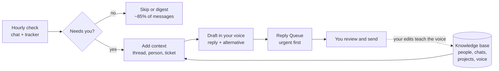
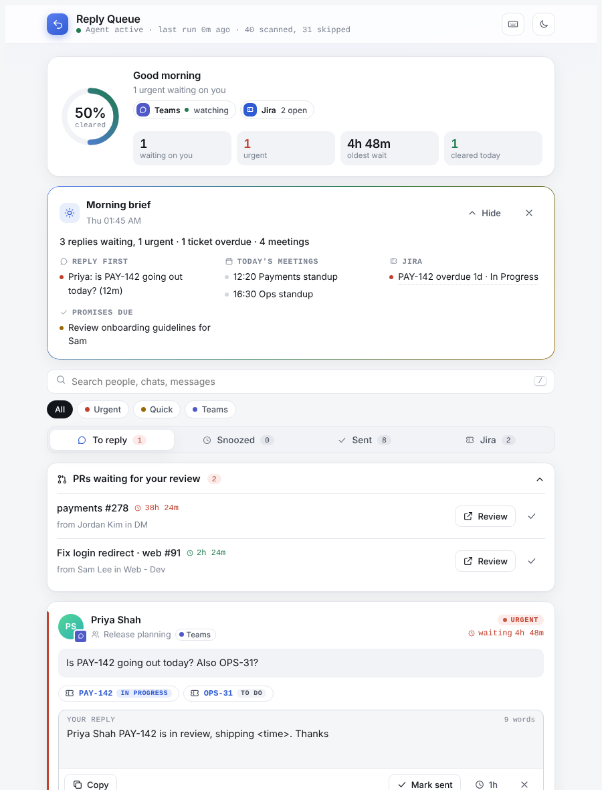
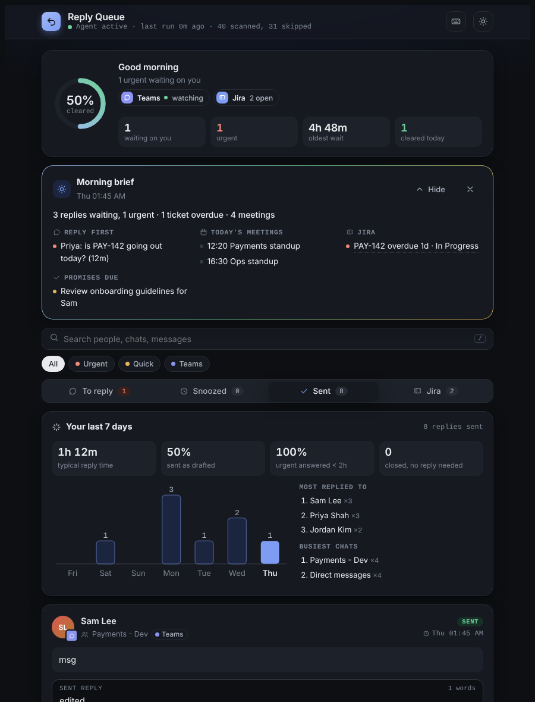
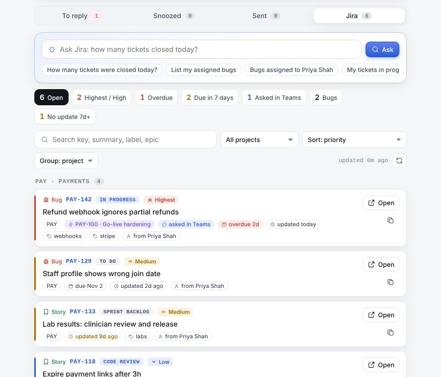
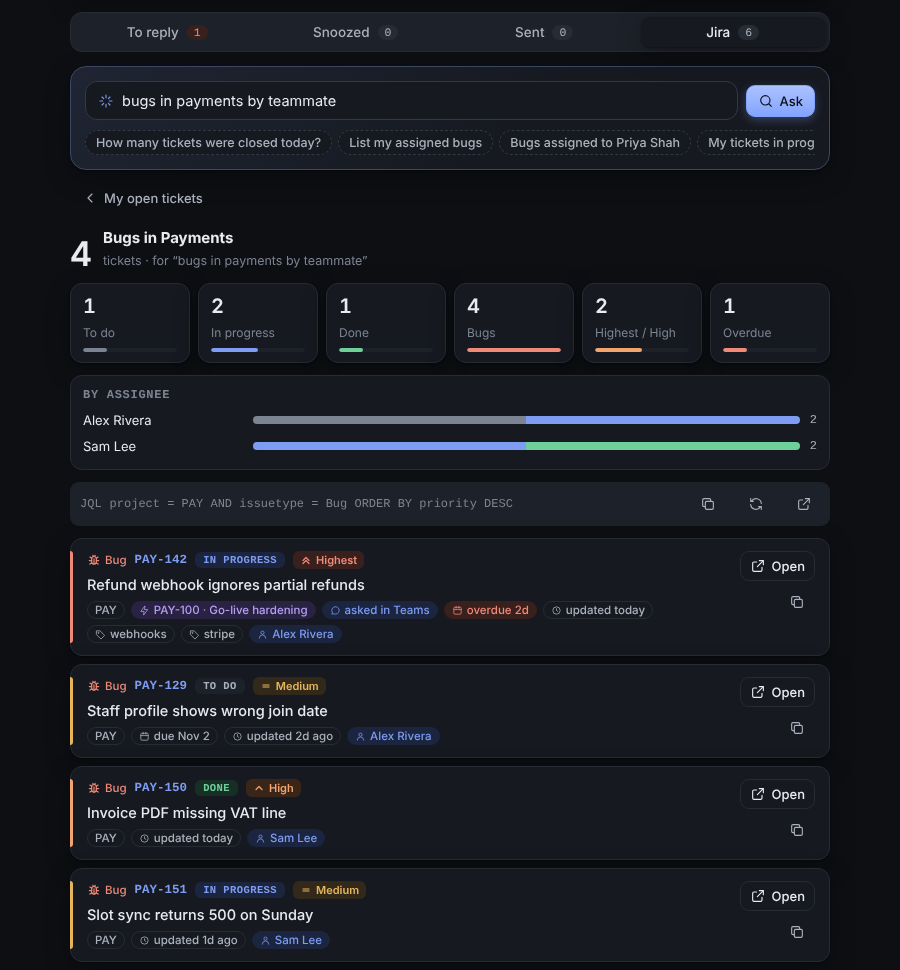

# Reply Agent

**An assistant for Claude that watches your work chat during working hours, skips the noise, and drafts replies in your own voice. You review and send.**

If you lead a team, you get tagged in a dozen chats all day. Most of it is banter, FYIs and meeting chatter. The few messages that really need you get buried, and some get missed. Reply Agent goes through that chat every hour and writes the replies that are needed. Every draft waits for you.



It never sends anything on its own.

<p align="center">
  
  
</p>
<p align="center">
  
  
</p>
<p align="center"><sub>Sample data. Names and messages are made up.</sub></p>

## What it does

| Feature | What you get |
| --- | --- |
| **Mention watcher** | Every hour in your working hours, it finds direct messages, @mentions and requests aimed at you. |
| **Noise filter** | Skips banter, polls, emoji-only messages, system events and muted chats. Status updates go into a one-line digest. |
| **Priority lanes** | Messages are sorted into **Urgent** (VIPs, "prod", "client", "go live", requests waiting too long), **Quick** (one-tap replies to "quick call?" or "ok to merge?") and **Normal**. |
| **Drafts in your voice** | It learns your style from your own messages: length, languages, greetings, sign-off, how you write to your manager or to a junior dev. Each message gets a main draft and a shorter alternative. |
| **Context** | Each draft rests on the thread before it, a memory of the person and the chat, and the ticket's status if you use a tracker. Anything it doesn't know becomes a `<placeholder>` so you never send a guess. |
| **Reply Queue page** | A private page with copy, send, open-in-chat, snooze and mark-sent buttons. It works on your phone. |
| **Send in Teams** | For 1:1 Teams chats, it opens the chat with your reply already typed in. You press Enter. |
| **Already-answered check** | No drafts for messages you already replied to in the same conversation. |
| **Commitment tracker** | Catches your own "I'll check", "will send by EOD" and adds them to your task list, along with what you are waiting on from others. |
| **Learns from your edits** | When you change a draft before sending, the difference is saved and used for the next drafts. |
| **Security check** | Flags it if you posted a password or token in chat. |
| **My Jira tab** (optional) | Your open tickets live from Jira: priority, type, status, epic, due date, labels, stale tickets and tickets someone asked about in chat. Filter, sort and group by project, status, epic or type. |
| **Ask Jira** | Type a question such as "how many tickets closed today?" or "bugs assigned to Sam". Claude turns it into JQL and shows the count, To do / In progress / Done stats and a per-assignee breakdown. |

## Requirements

- **Claude:** Cowork (desktop app) or Claude Code, with scheduled tasks and Artifacts available.
- **A chat connector:** Microsoft Teams (Microsoft 365 connector) is tested. Slack, Discord and Google Chat should work through their connectors; see [CONNECTORS.md](plugins/reply-agent/CONNECTORS.md).
- **Optional tracker:** Jira (Atlassian connector) is tested. Linear, Asana and GitHub Issues should work.
- **For the hourly run with a local knowledge base:** your computer must be on and the Claude desktop app open during working hours.

## Install

**Claude Code**

```
/plugin install reply-agent --marketplace Zeeshan138063/reply-agent
```

On older versions:

```
/plugin marketplace add Zeeshan138063/reply-agent
/plugin install reply-agent@reply-agent
```

**Claude Cowork (desktop app)**

Download `reply-agent.plugin` from the [latest release](https://github.com/Zeeshan138063/reply-agent/releases) and add it in Claude's plugin settings. You can also ask Claude to "install the plugin from github.com/Zeeshan138063/reply-agent".

## Set up (about 10 minutes)

Run:

```
/reply-setup
```

In Claude Code, plugin skills are listed with the plugin name in front, as `/reply-agent:reply-setup` and `/reply-agent:reply-drafts`. Both forms work.

It will:

1. Ask for your chat tool, tracker (or none), working hours and time zone.
2. Read the last 14 days of your chat to learn who you work with, which chats are noise, and what is still open.
3. Learn your voice from messages **you** wrote, and show you a summary to confirm.
4. Create your agent folder: config, short working memory, people, chats, projects, voice and tasks.
5. Publish your private Reply Queue page.
6. Schedule the hourly run.
7. Run once, so you have real drafts straight away.

Use `/reply-brief` for a morning brief or end-of-day wrap (setup can schedule both). After that, use `/reply-drafts` any time for an instant check, for example right after a meeting.

## Configure

All settings live in `config.md` in your agent folder. Edit them by hand, or tell Claude, e.g. "mute the #random channel" or "add my skip-level as a VIP". See the [config template](plugins/reply-agent/skills/reply-setup/references/config-template.md).

## Privacy and safety

- **It only drafts.** It never sends, posts, reacts or edits in chat, email or your tracker. You press send.
- **It reads only what you can already read**, through your own connectors and permissions.
- **Your data stays yours.** The knowledge base is plain markdown in a folder you choose. The Reply Queue is a private page that only you, and editors you add, can read.
- **No secrets are stored.** Passwords, tokens, payslips and personal data are left out of memory and drafts.
- **Placeholders block sending.** If a draft still has a `<placeholder>`, the Send button refuses until you fill it in.

If your company has rules about AI tools reading work chat, check them before you turn this on.

## Limits

- **Hourly, not instant.** Scheduled tasks run at most once an hour. For instant alerts from VIPs, follow the [instant alerts recipe](docs/instant-alerts.md) (Power Automate for Teams, Workflow Builder for Slack).
- **No direct send.** Most chat connectors are read-only by default. The Send button opens your chat app with the reply ready, or copies it.
- **Voice takes about a week to settle.** Edit drafts freely at first; every edit improves the next ones.

## Roadmap

- [x] Morning brief and end-of-day wrap
- [x] Standup prep from tracker and chat (Write my standup, in the Jira tab)
- [ ] PR review queue and approvals queue
- [ ] Meeting transcripts to decisions and action items
- [ ] Focus mode: hold non-urgent drafts during meetings
- [ ] Team mode: shared "who is waiting on whom" board
- [ ] Prefilled-compose links for Slack and Google Chat
- [x] Instant VIP alerts recipe (Power Automate / Slack workflows)

## Repository layout

```
.claude-plugin/marketplace.json        marketplace entry (for /plugin marketplace add)
plugins/reply-agent/
  .claude-plugin/plugin.json           plugin manifest
  CONNECTORS.md                        supported chat and tracker tools
  skills/reply-setup/                  one-time setup, voice learning, scheduling
  skills/reply-drafts/                 the hourly / on-demand run
  assets/reply-queue.html              the Reply Queue page
```

## Contributing

Issues and pull requests are welcome, especially:

- testing it on Slack, Discord or Google Chat
- better noise rules
- instant-alert recipes

Please don't include real chat content, names or company data in issues or examples.

## License

[MIT](LICENSE) © 2026 Zeeshan Muhammad
